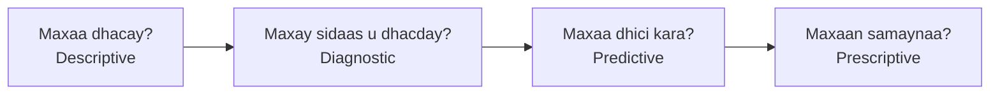

# Noocyada Falanqaynta

**Cutubka:** 2aad - Nidaamka Xogta 
**Casharka:** 1aad ee 7-da cashar  
**Dhammaadka casharkan:** Waxaad awoodi doontaa inaad kala saarto afarta nooc ee Falanqaynta (Analytics) iyo suʼaasha uu nooc walba ka jawaabo.

## Dulmar

Maamule ayaa eegaya warbixinta iibka bishii hore, wuxuuna qabaa afar suʼaalood:

- Maxaa dhacay?
- Maxay sidaas u dhacday?
- Maxaa dhici kara marka xigta?
- Maxaan samaynaa?

Suʼaal kasta waxay u baahan tahay nooc falanqayn ah oo ka duwan kuwa kale.

### Waa maxay Falanqayn (Analytics)?

**Falanqayn (Analytics)** waa adeegsiga xogta si loo fahmo waxa dhacay, sababta ay u dhacday, waxa dhici kara marka xigta, ama tallaabada la qaadayo.

### Afarta Nooc ee Falanqaynta

| Nooca | Suʼaasha | Tusaalaha |
|---|---|---|
| **Falanqaynta wixii dhacay (Descriptive analytics)** | Maxaa dhacay? | Iibka bariiska ayaa bishii hore kordhay 12% |
| **Falanqaynta sababta wax u dhaceen (Diagnostic analytics)** | Maxay sidaas u dhacday? | Iibku wuxuu u kordhay sababtoo ah dukaanka Hargeysa ayaa furnaa saacado dheeraad ah intii lagu jiray bisha ramadaan |
| **Falanqaynta saadaasha (Predictive analytics)** | Maxaa dhici kara marka xigta? | Iibku bisha soo socota wuu sii sarreyn karaa haddii saacadaha dheeraadka ah la sii wado |
| **Falanqaynta talo-bixinta (Prescriptive analytics)** | Maxaan samaynaa? | Sii wad saacadaha dheeraadka ah ee Hargeysa, kuna tijaabi Muqdisho |

Hab fudud oo lagu xasuusto waa:

**Wixii dhacay → Sababta → Waxa dhici kara → Tallaabada la qaadayo**

Bilowgu badanaa wuxuu ka bilaabmaa falanqaynta wixii dhacay, sida soo koobidda xogta, wadarta, iyo jaantusyada. Marka shaqadu sii horumarto, waxaa lagu daraa saadaal iyo talo-bixin.

### Maxay Tani Muhiim u Tahay?

Afarta nooc badanaa way isku xirmaan, inkastoo aanay ahayn afar tallaabo oo mar kasta khasab ah. Ma sharxi kartid sababta iibka bariisku u kordhay ilaa aad marka hore ogaato inuu kordhay. Fahamka sababta uu bishii hore u kordhay wuxuu xoojin karaa saadaasha bisha xigta. Talo-bixintuna waxay noqotaa mid lagu kalsoonaan karo marka suʼaalihii hore ay bixiyeen caddayn.

Sidaas darteed, marka ay shirkadu rabto saadaal, suʼaasha ugu horreysa waa: ma si sax ah ayay u sharxi kartaa wixii hore u dhacay?
