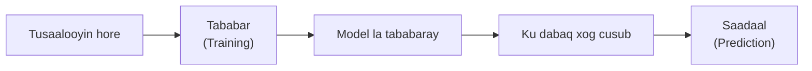

# Machine Learning

**Cutubka:** 2aad - Nidaamka Xogta  
**Casharka:** 4aad ee 7-da cashar  
**Dhammaadka casharkan:** Waxaad awoodi doontaa inaad sharaxdo sida Machine Learning uu tusaalooyin wax uga barto, sida uu ula xiriiro Data Science, iyo goorta loo baahan yahay.

## Dulmar

Sanduuqa farriimaha (Inbox) ayaa saaka farriin u wareejiyey qaybta spam-ka. Qofna ma qorin xeer si gaar ah u tilmaamaya qofka farriinta soo diray. Nidaamku wuxuu wax spam-ka u eg ka bartay malaayiin farriimood oo ay dadku hore u kala saareen. Taasi waa **Machine Learning**.

### Waa maxay Machine Learning?

**Machine Learning (ML)** waa qayb ka mid ah garaad gacmeedka (Artificial Intelligence ama AI). Waa hab ay kombiyuutarradu qaababka (patterns) uga bartaan xogta, halkii xeer kasta si gaar ah loogu qori lahaa.

Tusaalooyinka waxaa ka mid ah:

- Ogaanshaha fariimaha spam-ka ah
- Talooyinka filimada (movie recommendations)
- Aqoonsiga codka
- Kala saarista sawirrada
- Saadaalinta macaamiisha joojin kara isticmaalka adeegga

Nidaamku wuxuu tusaalooyin hore wax ka bartaa inta lagu jiro **tababarka (training)**. Nidaamka la tababaray waxaa loo yaqaan **model**. Model-ku wuxuu qaababka uu bartay ku dabaqaa xog cusub si uu saadaal u sameeyo ama goʼaan u gaaro.

### Xiriirka Machine Learning iyo Data Science

Data Scientist-yadu waxay mararka qaarkood isticmaalaan Machine Learning marka mashruucu u baahan yahay saadaal ama in qaababka si toos ah (automatically) loo aqoonsado. Laakiin labaduba isku mid ma aha:

- Data Science wuxuu soo saari karaa shaqo waxtar leh isaga oo aan isticmaalin Machine Learning
- Machine Learning waxaa lagu isticmaali karaa Data Science iyo alaabo software ah (software products)
- Model-ku wuxuu weli u baahan yahay tirakoob, barnaamij-samayn, xog la isku halayn karo, iyo aqoonta dhibaatada dhabta ah

Machine Learning waa hab uu Data Science isticmaali karo, mana aha magac kale oo loo yaqaan Data Science.

### Goorma ayuu Mashruuc u Baahan Yahay Machine Learning?

Machine Learning wuxuu faaʼiido leeyahay marka qaabka la raadinayo uu aad u adag yahay in lagu qoro xeerar la isku halayn karo. Qofna ma qori karo jumlad kasta oo fariin ka dhigaysa spam, sidaas darteed nidaamku waa inuu tusaalooyin wax ka bartaa.

Machine Learning ma aha qalabka saxda ah marka xeer fudud uu dhibaatada xallin karo ama marka aan la hayn tusaalooyin ku habboon:

| Suʼaasha | Waxa ay u baahan tahay |
|---|---|
| Xirmadee ayaa bishii hore ugu iib badnayd? | Tirin; tani waa descriptive analytics |
| Calaamadee lacag-dirid kasta oo ka badan `$500` | Hal xeer oo cad |
| Macaamiishee ayaa joojin doona lacag ku shubashada bisha soo socota? | Model lagu tababaray macaamiil hore u joojisay |

Saddexdan tusaale dhexdooda, dhibaatada saddexaad oo keliya ayaa u baahan Machine Learning. Waxaa la xallin karaa oo keliya haddii shirkaddu hayso diiwaanno lagu kalsoonaan karo oo muujinaya macaamiishii joojisay, goorta ay joojiyeen, iyo sida hab-dhaqankoodu ahaa ka hor inta aanay joojin.

**Tusaalooyin laʼaan, model ma jiro.**

### Tusaale

Data Scientist-kii casharkii hore wuxuu baaray sababta hoos u dhaca cusboonaysiinta xirmooyinka. Hadda shirkadda isgaarsiintu waxay rabtaa inay ogaato macaamiisha laga yaabo inay baxaan bisha soo socota.

Macaamiishii hore ayaa ah tusaalooyinka tababarka (training examples). Inta jeer ee ay lacag ku shubteen, xirmooyinka ay doorteen, iyo taariikhda adeeggooda waxay noqdaan xogta la geliyo (inputs). Inay markii dambe baxeen iyo in kale waxay noqotaa natiijada la yaqaan (known outcome). Model-ku wuxuu bartaa xiriirka ka dhexeeya xogta la geliyey iyo natiijadaas, kadibna macaamiisha hadda jooga wuxuu siiyaa saadaal muujinaysa halista bixitaanka.

Saadaashaasi iskeed ma sharxayso sababta macmiilku u bixi karo, mana goʼamiso tallaabada ay shirkaddu qaadayso. Waxay bixisaa qayb caddaynta ka mid ah oo ay dadku qiimayn karaan, tallaabana ku salayn karaan.
