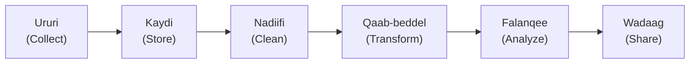

# Halka Xogtu Ku Kaydsan Tahay iyo Data Pipeline-ka

**Cutubka:** 2aad - Nidaamka Xogta  
**Casharka:** 5aad ee 7-da cashar  
**Dhammaadka casharkan:** Waxaad awoodi doontaa inaad sheegto marxaladaha dataset-ku maro iyo halka lagu kaydiyo marxalad kasta.

## Dulmar

Tirada iibka ee maamuluhu saaka dashboard-ka ku arkay waxay saddex toddobaad ka hor ku bilaabatay lacag mobile money ah oo lagu bixiyey kiish bariis ah. Intii u dhexaysay lacag-bixinta iyo dashboard-ka, xogta waa la ururiyey, la kaydiyey, la nadiifiyey, qaabkeeda waa la beddelay, waana la soo koobay. Badanaa shaqadaas waxaa qabta nidaamyo aanay dadka shirka jooga arag.

Xogtu hal meel oo keliya kuma jirto. Waxay martaa nidaamyo iyo marxalado kala duwan ka hor inta aanay noqon mid waxtar leh.

### Halka Xogtu Ku Kaydsan Tahay

Shirkaduhu waxay xogta ku kaydiyaan nidaamyo kala duwan marka loo eego ujeeddada iyo baaxadda xogta.

| Nidaamka | Ujeeddada |
|---|---|
| **Database** | Kaydinta iyo soo saaridda xog ganacsi oo habaysan, gaar ahaan hawl maalmeedka |
| **Data warehouse** | Kaydinta xog habaysan oo loogu talagalay falanqayn |
| **Data lake** | Kaydinta xog cayriin ah oo qaabab kala duwan leh, badanaana tiro badan |
| **Jadwallo iyo faylal (spreadsheets/files)** | Kaydinta datasets yar iyo qabashada shaqo degdeg ah |

Farqiga muhiimka ahi waa ujeeddada nidaam kasta. Database waxaa loo dhisaa inuu diiwaangeliyo waxa hadda dhacaya, hal iib ama macaamil (transaction) markiiba. Data warehouse waxaa loo dhisaa inuu ka jawaabo suʼaalo ku saabsan xogtii sannadihii hore. Haddii database-ka dukaanka la weydiiyo suʼaal u baahan xogta saddexdii sano ee la soo dhaafay, suʼaashaasi waxay gaabin kartaa nidaamka hawl maalmeedka ee dukaanka.

### Waa maxay Data Pipeline?

**Data pipeline** waa hab-socodka ay xogtu marto laga bilaabo isheeda ilaa isticmaalkeeda ugu dambeeya.

Marxalad kasta waxay leedahay ujeeddo:

- **Ururi (Collect):** xog ka soo ururi apps-ka, foomamka, sensors-ka, ama nidaamyada
- **Kaydi (Store):** ku kaydi database, data warehouse, ama fayl
- **Nadiifi (Clean):** sax qiimeyaasha maqan, xogta soo noqnoqotay, iyo khaladaadka
- **Qaab-beddel (Transform):** xogta u beddel qaab waxtar leh
- **Falanqee (Analyze):** baar qaababka oo ka jawaab suʼaalaha
- **Wadaag (Share):** natiijooyinka ku soo bandhig warbixinno ama dashboards

### Tusaale

La soco sida xogtaasi uga soo gudubto nidaamka mobile money-ga ilaa dashboard-ka maamulaha:

1. Data pipeline-ka ganacsaduhu wuxuu **ururiyaa (Collect)** xogta lacag-bixinnada ee ka timaadda nidaamka mobile money-ga
2. Xogta waxaa lagu **kaydiyaa (Store)** database, data warehouse, ama meel kale oo uu ganacsaduhu xogtiisa ku hayo
3. Data pipeline-ku wuxuu **nadiifiyaa (Clean)** xogta, isaga oo ka saaraya diiwaannada soo noqnoqda, lacag-bixinnada la celiyey, iyo khaladaadka kale
4. Xogta waxaa loo **qaab-beddelaa (Transform)** qaab waxtar leh, sida wadarta iibka maalinlaha ah ee dukaan kasta
5. Falanqeeye (analyst) ayaa **falanqeeya (Analyze)** xogta si uu u ogaado dukaamada iibkoodu kordhayo iyo kuwa aanu isbeddelin
6. Natiijooyinka waxaa lagu **wadaagaa (Share)** dashboard-ka, halkaas oo maamuluhu ka arki karo

Xogtu waxay martay lix marxaladood, laakiin tirada dashboard-ka ku jirta ayaa ah qaybta keliya ee ay dadka shirka jooga arkaan.
