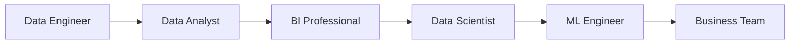

# Sida ay Doorarka Xogtu u Wada Shaqeeyaan

**Cutubka:** 2aad - Nidaamka Xogta  
**Casharka:** 7aad ee 7-da cashar  
**Dhammaadka casharkan:** Waxaad awoodi doontaa inaad sharaxdo sida doorarka xogtu u wada shaqeeyaan iyo sababta magaca shaqadu aanu kaliya sheegin waxa qofku qabto.

## Dulmar

Hal macmiil ayaa joojiyey cusboonaysiinta xirmadiisa billaha ah. Lix qof oo shaqooyin kala duwan qabta ayaa ugu dambayn ka shaqaynaya dhacdadaas, midkoodna keligiis ma qaban karo shaqada oo dhan.

Data Analysis, Business Intelligence, Data Science, Machine Learning, iyo Data Engineering waa qaybo kala duwan oo isku xiran. Marka lagu daro dadka isticmaala natiijooyinkooda, waxay wada sameeyaan **nidaamka xogta (data ecosystem)**.

### Sida ay u Wada Shaqeeyaan

Aan eegno sida doorarka kala duwani u baaraan hoos u dhaca cusboonaysiinta xirmooyinka mobile data.

Jaantuskani wuxuu muujinayaa hal hab ay shaqadu u socon karto:

Jaantuskani wuxuu muujinayaa sida xogta iyo natiijooyinka mashruuca uga gudbaan koox una gudbaan koox kale. Ma aha waddo qofku shaqooyin ugu kala gudbayo, mashruuc kastana uma baahna dhammaan doorarkan. Kooxda ganacsigu waxay goʼaan ku gaari kartaa falanqaynta iyada oo aan model la dhisin.

1. **Data Engineer** ayaa ururiya diiwaannada lacag-ku-shubashada iyo xirmooyinka, kadibna ka dhiga kuwo lagu kalsoonaan karo
2. **Data Analyst** ayaa xaqiijiya in heerka cusboonaysiinta xirmooyinka uu hoos u dhacay, wuxuuna ogaadaa goorta iyo halka hoos u dhacu ka bilowday
3. **BI Professional** ayaa dhisa dashboard toddobaad kasta muujinaya heerka cusboonaysiinta
4. **Data Scientist** ayaa baara sababaha suurtagalka ah, wuxuuna tijaabiyaa in caddayntu taageerayso sababahaas
5. Haddii saadaalintu caawinayso, **Machine Learning Engineer** ayaa model-ka ku dara nidaamka si loo calaamadeeyo macaamiisha laga yaabo inay baxaan
6. **Kooxda ganacsiga (Business Team)** ayaa goʼaamisa inay qiimaha beddesho, qiimo dhimis sameyso, ama tallaabo kale qaaddo

### Halka ay Noocyada Analytics-ku Kaga Jiraan

- **Falanqaynta wixii dhacay (Descriptive analytics):** waxay sheegtaa in heerka cusboonaysiinta xirmooyinka uu hoos u dhacay
- **Falanqaynta sababta wax u dhaceen (Diagnostic analytics):** waxay baartaa sababta heerku hoos ugu dhacay
- **Falanqaynta saadaasha (Predictive analytics):** waxay qiyaastaa macaamiisha laga yaabo inay baxaan marka xigta
- **Falanqaynta talo-bixinta (Prescriptive analytics):** waxay isbarbar dhigtaa tallaabooyinka suurtagalka ah, kadibna waxay ku talisaa waxa la samaynayo

Afartan nooc ma aha afar shaqo oo kala duwan, mar walbana si isku xigta uma dhacaan. Waa afar nooc oo suʼaalo ah oo ay dad kala duwan oo nidaamka xogta ka tirsan gacan ka geysan karaan ka jawaabistooda.

### Magaca Shaqadu Mar Walba Ma Muujiyo Waxa Shaqadu Tahay

Shirkad ayaa Data Analyst ugu yeerta qof xogta baara, halka shirkad kale qofkaas inta badan u dirto samaynta dashboards. Shaqada dashboards-ka shirkad kale waxay ugu yeeri kartaa Business Intelligence. Sidaas darteed, akhri sharaxaadda shaqada (job description): suʼaalahee ayuu qofku ka jawaabayaa, muxuuse soo saarayaa?

Magacyo kale oo aad la kulmi karto waxaa ka mid ah **Analytics Engineer**, oo xogta kaydsan u diyaariya falanqayn, halka Data Engineer uu xoogga saaro nidaamyada ururinta, dhaqaajinta, iyo kaydinta. **Business Analyst** wuxuu qeexaa baahida ganacsiga iyo xalalka suurtagalka ah. **Business Stakeholder** waa qof ama koox ay natiijadu khusayso ama goʼaanka gaaraysa.

Qofna silsiladdan shaqada oo dhan ma qaban, loomana baahnayn. Qof walba wuxuu u baahnaa inuu ogaado wixii ka horreeyey shaqadiisa, waxa ay shaqadiisu ku dartay, iyo sida qofka xiga u isticmaali doono.
