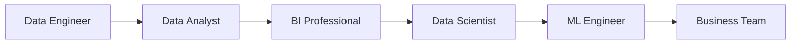

# Sida ay Doorarka Xogtu u Wada Shaqeeyaan

**Cutubka:** 2aad - Nidaamka Xogta  
**Casharka:** 7aad ee 7-da cashar  
**Dhammaadka casharkan:** Waxaad awoodi doontaa inaad sharaxdo sida doorarka xogtu isugu tiirsan yihiin marka ay hal mashruuc ka wada shaqaynayaan.

## Dulmar

Hal macmiil ayaa joojiyey cusboonaysiinta xirmadiisa billaha ah. Lix qof oo shaqooyin kala duwan qabta ayaa ugu dambayn ka shaqaynaya dhacdadaas, midkoodna keligiis ma qaban karo shaqada oo dhan.

Falanqaynta xogta (data analysis), Business Intelligence, Data Science, Machine Learning, iyo Data Engineering waa qaybo kala duwan oo isku xiran. Marka lagu daro dadka isticmaala natiijooyinkooda, waxay wada sameeyaan **nidaamka xogta (data ecosystem)**.

### Hal Nidaam, Doorar Badan

Hayʼadaha casriga ah, waa dhif in hal qof keliya qabto dhammaan shaqada xogta. Kooxo leh aqoon iyo shaqooyin kala duwan ayaa wada shaqeeya.

Doorarka caadiga ah waxaa ka mid ah:

- **Data Engineer:** wuxuu dhisaa data pipelines iyo nidaamyada kaydinta
- **Falanqeeye xog (Data Analyst):** wuxuu baaraa xogta oo ka jawaabaa suʼaalaha
- **Xirfadle BI (BI Professional):** wuxuu dhisaa dashboards oo la socda KPIs
- **Data Scientist:** wuxuu baaraa dhibaatooyin adag oo tijaabiyaa xalalka suurtagalka ah
- **ML Engineer:** wuxuu model saadaalin sameeya ku daraa software ama adeeg, kadibna hubiyaa inuu sii shaqaynayo
- **Qofka ganacsiga ay arrintu khusayso (Business Stakeholder):** wuxuu weydiiyaa suʼaalaha oo adeegsadaa natiijooyinka

Magacyada jagooyinku way kala duwanaan karaan. Hayʼad yar gudaheeda, hal qof ayaa qaban kara dhowr ka mid ah doorarkan. Waxa muhiimka ahi waa shaqada uu qof walba ku darsado, ma aha magaca jagada ku qoran kaarkiisa shaqada.

### Sida ay u Wada Shaqeeyaan

Hal macmiil ayaa joojiyey cusboonaysiinta xirmadiisa mobile data-ga ee billaha ah. La soco sida doorarka kala duwani uga wada shaqeeyaan dhacdadaas.

Jaantuskani wuxuu muujinayaa hal hab ay shaqadu u socon karto:

1. **Data Engineer** ayaa ururiya diiwaannada lacag-ku-shubashada iyo xirmooyinka, kadibna ka dhiga kuwo lagu kalsoonaan karo
2. **Data Analyst** ayaa xaqiijiya in heerka cusboonaysiinta xirmooyinka uu hoos u dhacay, wuxuuna ogaadaa goorta iyo halka hoos u dhacu ka bilowday
3. **BI Professional** ayaa dhisa dashboard toddobaad kasta muujinaya heerka cusboonaysiinta
4. **Data Scientist** ayaa baara sababaha suurtagalka ah, wuxuuna tijaabiyaa in caddayntu taageerayso sababahaas
5. Haddii saadaalintu caawinayso, **ML Engineer** ayaa model-ka geliya xaalad isticmaal si loo calaamadeeyo macaamiisha laga yaabo inay baxaan
6. **Kooxda ganacsiga (Business Team)** ayaa goʼaamisa inay qiimaha beddesho, xirmo yar bixiso, ama tallaabo kale qaaddo

Model-ka tallaabada shanaad qasab ma aha. Waxaa lagu daraa oo keliya haddii saadaalinta macaamiil gaar ahi ay caawinayso goʼaanka ganacsiga. Wuxuu sidoo kale ku tiirsan yahay diiwaannada lagu kalsoonaan karo ee tallaabada koowaad iyo dhibaatada sida cad loo qeexay ee tallaabooyinka kale lagu baaray.

### Halka ay Noocyada Analytics-ku Kaga Jiraan

- **Falanqaynta wixii dhacay (Descriptive analytics):** waxay sheegtaa in heerka cusboonaysiinta xirmooyinka uu hoos u dhacay
- **Falanqaynta sababta wax u dhaceen (Diagnostic analytics):** waxay baartaa sababta heerku hoos ugu dhacay
- **Falanqaynta saadaasha (Predictive analytics):** waxay qiyaastaa macaamiisha laga yaabo inay baxaan marka xigta
- **Falanqaynta talo-bixinta (Prescriptive analytics):** waxay isbarbar dhigtaa tallaabooyinka suurtagalka ah, kadibna waxay ku talisaa waxa la samaynayo

Afartan nooc ma aha afar shaqo oo kala duwan, mar walbana si isku xigta uma dhacaan. Waa afar nooc oo suʼaalo ah oo ay dad kala duwan oo nidaamka xogta ka tirsan gacan ka geysan karaan ka jawaabistooda.

### Qodobka Muhiimka ah

Qofna silsiladdan shaqada oo dhan ma qaban, loomana baahnayn. Qof walba wuxuu u baahnaa inuu ogaado wixii ka horreeyey shaqadiisa, waxa ay shaqadiisu ku dartay, iyo sida qofka xiga u isticmaali doono.

Taasi waa faaʼiidada dhabta ah ee fahamka nidaamka xogta. Looma baahna inaad dhammaan qaybaha ka shaqayso, laakiin waa inaad garataa waxa qof kale kuu soo gudbiyey iyo waxa lagaaga baahan yahay inaad ku darto.
