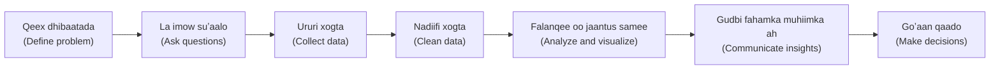

# Qeex Dhibaatada oo La Imow Suʼaalo

**Cutubka:** 3aad - Hab-socodka Xogta  
**Casharka:** 1aad ee 6-da cashar  
**Dhammaadka casharkan:** Waxaad awoodi doontaa inaad codsi aan caddayn u beddesho suʼaal falanqayn oo gaar ah.

## Dulmar

“Ma eegi kartaa xogta iibka?” waa mid ka mid ah codsiyada ugu badan ee uu helo falanqeeye, welina ma aha suʼaal cad. Haddii codsigaas sida uu yahay lagu bilaabo, toddobaad ayaa lumi kara.

Falanqaynta wanaagsani waxay bilaabataa ka hor inta aan xog la ururin. Marka hore waa inaad fahantaa dhibaatada oo ay suʼaashu cadaataa. Haddii tallaabadan laga boodo, xitaa qalab horumarsan wuxuu soo saari karaa natiijo aan waxtar lahayn.

### Ka Bilow Dhibaatada Ganacsiga

**Dhibaatada ganacsiga (business problem)** waa arrinta ama goʼaanka ay falanqayntu taageerayso.

Khalad caam ah ayaa ah in si toos ah xogta loogu boodo iyada oo aan la garanayn waxa la xallinayo.

Mar walba ku bilow suʼaalahan:

- Dhibaato noocee ah ayaan xallinaynaa?
- Yaa ay jawaabtu muhiim u tahay?
- Goʼaankee ayay falanqayntani taageeraysaa?

Tusaale:

- Suʼaal aan caddayn: “Aan eegno jadwalka iibka.”
- Suʼaal cad: “Muxuu iibka bariisku labadii toddobaad ee u dambeeyey hoos ugu dhacay marka la barbar dhigo bishii ka horreysay?”

### Garashada Dadka ay Natiijadu Khusayso

**Qof ama koox ay natiijadu khusayso (stakeholder)** waa qof ama koox ay natiijada falanqayntu saamayso ama dan ka leh natiijada.

Tusaalooyin:

- Maamule goʼaan ka gaaraya kharashka suuqgeynta (marketing spend)
- Kooxda product-ga oo hagaajinaysa qayb (feature) ka mid ah app-ka
- Kooxda maaliyadda oo dib u eegaysa sida miisaaniyadda loo isticmaalay

Garashada dadka ay natiijadu khusayso waxay kaa caawinaysaa inaad:

- La timaaddo suʼaalaha saxda ah
- Doorato cabbirrada (metrics) ku habboon
- Natiijooyinka u soo bandhigto hab waxtar leh

### Sida Loola Yimaaddo Suʼaalo Falanqayn oo Wanaagsan

**Suʼaal falanqayn (analytical question)** waa suʼaal cad oo xogtu kaa caawin karto inaad ka jawaabto.

Suʼaalaha falanqaynta ee wanaagsan waa:

- **Gaar ah (specific):** waxay diiradda saartaa hal arrin
- **La cabbiri karo (measurable):** xog ayaa lagaga jawaabi karaa
- **Khusaysa (relevant):** waxay xiriir la leedahay goʼaan dhab ah
- **Cad (clear):** dadka kale si fudud ayay u fahmi karaan

Tusaalooyin:

- Alaabtee lahayd heerka soo-celinta (return rate) ugu sarreeya bishii hore?
- Macaamiisha cusub ma u badan yihiin inay joojiyaan dalabaadka bishooda koowaad?
- Saddexda magaalo, tee ayaa ugu gaabisa bixinta biilasha (invoices)?

### Bilowgu Waa Isku Mid, Wax Kasta oo La Dhisayo

Qaybihii Cutubka 2aad waxay ku kala duwan yihiin waxa ay soo saaraan: warbixin, dashboard, ama model la tababaray. Waxa aanay ku kala duwanayn waa sida ay ku bilowdaan.

Data Scientist-ka goʼaaminaya in model la dhiso iyo in kale wuxuu la yimaaddaa isla saddexda suʼaalood ee kore.

Suʼaal aan goʼaan lagu salaynayn ma mudna in waqti lagu bixiyo, si kasta oo habka loo adeegsaday u horumarsan yahay.

### Tusaale

Xarun tababar oo Muqdisho ku taal ayaa ogaatay in tirada ardayda isdiiwaangelinaysa ay yaraanayso.

**Dadka ay natiijadu khusayso:** maamulaha xarunta iyo qofka qaabilsan soo jiidashada ardayda cusub (recruitment)  
**Dhibaatada:** isdiiwaangelinta ardayda ayaa hoos u dhacaysa  
**Suʼaalaha:**

- Goormay isdiiwaangelintu bilowday inay hoos u dhacdo?
- Isdiiwaangelintu koorsooyinka oo dhan ma ku yaraatay, mise qaar keliya?
- Tirada dadka raadinaya koorsooyinka ma yaraatay, mise tiradu waa isku mid laakiin dadku ma isdiiwaangelinayaan?

Suʼaalahan ayaa hagaya tallaabo kasta oo ka dambaysa.
