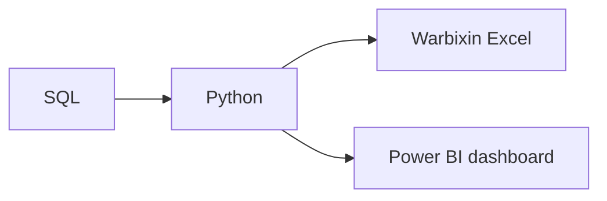

# Agabka Casriga ah ee Xogta

**Cutubka:** 4aad - Xogta Dunida Dhabta ah  
**Casharka:** 1aad ee 3-da cashar  
**Dhammaadka casharkan:** Waxaad awoodi doontaa inaad doorato qalabka (tool) ku habboon hawl, isla markaana sharaxdo sida qalabyada kala duwan loogu wada isticmaalo hal mashruuc.

## Dulmar

Qof kasta oo ku cusub xogta wuxuu isweydiiyaa qalabka (tool) uu marka hore baranayo. Laakiin marka hore waa in la ogaado hawsha la qabanayo, kadibna qalabka ku habboon loo doorto.

Qalabka saxda ahi badanaa waa qalabka ugu fudud ee hawsha si fiican u qaban kara.

### Sababta ay qalab badan u jiraan

Ma jiro hal qalab oo wax walba si fiican u qabta. Qaar waxaa loo sameeyay xog yar, qaarna kaydad xogeed waaweyn, halka qaar kale loogu talagalay samaynta dashboards ama qorista koodhka. Shaqooyinkooda qaarkood way is-dulsaarmaan, sidaas darteed kooxaha badankood waxay isku mar adeegsadaan dhowr qalab.

Uma baahnid inaad dhammaantood si qoto dheer u barato. Waxa muhiimka ahi waa inaad garato qalab kasta waxa loo isticmaalo, si marka uu qof magaciisa sheego aad si guud u fahanto waxa uu qabto.

### Qalabyada Muhiimka ah ee Shaqada Xogta

| Qalabka | Waxa uu yahay | Goorta la adeegsado |
|---|---|---|
| **Excel / Google Sheets** | Jadwal (spreadsheet) xogta lagu habeeyo laguna xisaabiyo | Falanqayn degdeg ah, datasets yar, iyo warbixinno ganacsi |
| **SQL** | Luuqad database-ka loogu diro codsi xog raadis ah (query) | Soo saaridda iyo soo koobidda xog ka badan inta spreadsheet-ku si fudud u qaadi karo |
| **Python** | Luuqad programming oo guud | Falanqayn, iyo nadiifin |
| **Jupyter Notebook** | Meel code lagu qoro laguna wadaago, iyadoo qoraallo la raacin karo | Baarista xogta tallaabo tallaabo |
| **Power BI** | Qalab lagu dhiso laguna wadaago dashboards ay dadku isticmaali karaan | La wadaagidda dashboards ay kooxaha ganacsigu isticmaali karaan |
| **Git iyo GitHub** | Qalab lagu diiwaangeliyo isbeddellada faylasha muddo ka dib (version control) | Wada shaqaynta iyo dib-u-eegista shaqada ka hor inta aan la dhammaystirin |

Mashruucyo badan ayaa adeegsadaa dhowr qalab.

### Tusaale Sida Qalabku Isugu Xirmo

Mashruuc lagu falanqaynayo iibka, xogta waxaa database-ka looga soo saaraa SQL. Kadib, xogta waxaa lagu nadiifiyaa laguna falanqeeyaa Python. Natiijooyinka waxaa markaas loo gudbiyaa laba qaab: warbixin kooban oo Excel ah iyo dashboard Power BI ah oo ay maamulayaashu isticmaalaan.

Sidaad aragto, hal shaqo ayaa u baahan karta dhowr qalab. Ma jiro hal qalab ama qalabyo goʼan oo shaqo kasta qaban kara. Hawl kasta waxaa loo doortaa qalabka ku habboon.

Git iyo GitHub waxay la socdaan habka shaqada oo dhan, iyaga oo diiwaangelinaya isbeddel kasta oo ka dhaca tallaabo kasta.

SQL iyo Python labaduba waxay ku lug leeyihiin qorista code. Casharka xiga wuxuu sharxayaa sababta shaqada xogtu ugu baahan tahay code.
