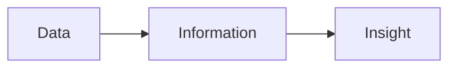

# What Is Data?

**By the end:** You can explain what data is, and tell data, information, and insight apart.

## Overview

You check your phone and see a digital wallet transfer of `$25`, a weather app showing `32°C`, and a message from school about your attendance. Each of those is a piece of data, a small fact about something that happened. Before you analyze data, build dashboards, or choose a career in data, you need a clear answer to a simple question: what is data?

### Raw facts about the world

**Data** is a collection of facts, measurements, or observations about the world. On its own, data usually does not tell a full story. It is the raw material we use to understand what is happening.

Examples of data:

- A digital wallet transfer amount: `$25`
- A market price for rice: `$2.50 per kg`
- A student's attendance record: `present`
- A product price: `$49.99`
- A temperature reading: `32°C`

Each example is a single fact. Collect enough of them and patterns start to appear.

### Data vs information vs insight

These three terms are related, but they are not the same.

| Term | Meaning | Example |
|---|---|---|
| **Data** | Raw facts | Sales were `$1,200`, `$980`, and `$1,450` on three days |
| **Information** | Data organized to answer a basic question | Sales increased from Monday to Wednesday |
| **Insight** | A useful conclusion that can guide action | Promotions on Wednesday may be driving higher sales |

A simple example: Facebook

You posted a photo, a text post, and a video on Facebook. They received `20`, `45`, and `90` likes.

- Those like counts are **data**.
- Knowing that the video received the most likes is **information**.
- The people who follow your page seem to prefer video over photos and text posts. So next time, you might create another video. That is an important **insight**.

### Where you see data every day

Data is not only found in spreadsheets or databases. You create and use data constantly:

- Digital wallet transactions and bank transfers
- School grades and attendance records
- Market prices at a local shop
- Likes and comments on social media
- Steps tracked by a fitness app
- Weather forecasts

Businesses, schools, hospitals, and governments all rely on data to make decisions.
