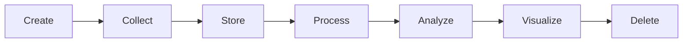

# The Data Lifecycle

**By the end:** You can name the stages data passes through, from the moment it is created to the moment it is deleted.

## Overview

A shop records a sale of rice at `$2.50 per kg` on a Tuesday morning. Four years later that same record is deleted from a backup nobody has opened since. Between those two moments it was stored, corrected, counted, and drawn on a chart a manager looked at for six seconds. Data has a life, and most of that life happens outside the moment people picture when they say "collecting data".

### What is the data lifecycle?

The **data lifecycle** is the full path data follows from the moment it is created to the moment it is deleted.

Follow one sack of rice through all seven.

| Stage | What happens | The rice sale |
|---|---|---|
| **Create** | Something happens in the world and produces a fact | A customer pays for a sack of rice |
| **Collect** | The fact is recorded somewhere | The digital wallet saves the payment |
| **Store** | The record is kept where it can be found again | It joins millions of others in a database |
| **Process** | The record is corrected and reshaped for use | Reversed payments are dropped, daily totals worked out |
| **Analyze** | Someone asks the data a question | Which branch sold the least rice in August? |
| **Visualize** | The answer is put in a form people read quickly | One bar per branch |
| **Delete** | The data is archived, then destroyed | Records older than four years move to slower storage, then go |

Not every dataset reaches every stage. Plenty of data is created and never collected, and plenty is collected and never looked at again.

### Creating is not the same as collecting

Data is created whether or not anyone records it. Every sale in a shop that keeps no records still happened. What separates a fact from a data point is that somebody wrote it down.

This gap is the first place an analysis can go wrong, and it goes wrong quietly. A missing value leaves a blank cell you can see. Data you never collected leaves nothing at all, so there is no gap to notice and no cell to question.

### Processing is where the time goes

To **process** data is to turn it into the form the next stage needs: correcting errors, handling gaps, and reshaping records into the layout something else expects.

It is the least visible stage and usually the longest. Nobody presents the processing. They present the chart, which is four stages downstream of the payment and looks nothing like it.

Processing covers a wide range, from fixing a badly typed date to reorganizing millions of rows, and each of those is a subject in its own right.

### Data does not live forever

**Archiving** is moving data out of everyday systems into slower, cheaper storage where it can still be recovered if it is needed.

Deleting is the stage people forget exists. Storage costs money every month, and personal data that is no longer needed can still be lost, leaked, or used for something the person never agreed to. A record that serves no purpose is safer gone.

### Where data sits in its life changes what it can tell you

A number on a dashboard is five stages away from the thing that happened. Each of those stages is a place where the record could have been corrected, reshaped, dropped, or never made in the first place.

Asking where a number sits in its life is the quickest way to judge it. A figure read straight out of a payment system and a figure pulled from a four-year-old archive are both data. They are not the same evidence.
