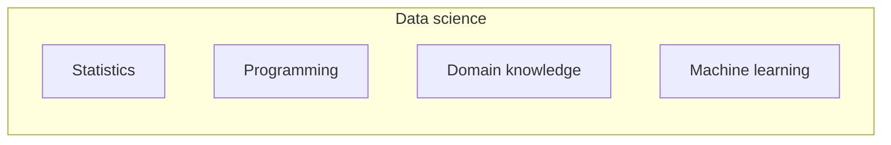

# Data Science and Machine Learning

**Chapter:** 2 - The Data Ecosystem  
**Lesson:** 3 of 6  
**By the end:** You can explain how machine learning fits inside data science, and when a project actually needs it.

## Overview

Your inbox quietly moved a message to spam this morning. Nobody wrote a rule naming that exact sender. Something learned what spam looks like, from millions of messages other people marked before you. **Data science** and **machine learning** are often mentioned together, but they are not the same thing.

### What is data science?

**Data science** combines statistics, programming, domain knowledge, and data analysis to extract insights and build data-driven solutions.

Data scientists often work on problems such as:

- Forecasting demand
- Detecting fraud
- Recommending products
- Analyzing complex datasets

Data science usually goes beyond basic reporting. It may involve advanced analysis, experimentation, and model building.

### What is machine learning?

**Machine learning (ML)** is a branch of artificial intelligence where computers learn patterns from data instead of being explicitly programmed for every rule.

Examples:

- Email spam detection
- Movie recommendations
- Voice recognition
- Image classification

Instead of writing every rule manually, the system learns from examples.

The trained system is called a **model**. It uses learned patterns to make predictions or decisions about new data.

### How they relate

Machine learning is one tool within data science, alongside several others.

A data scientist reaches for statistics, programming, and knowledge of the business as readily as for a model. Machine learning is the tool that gets the attention, not the tool that gets used most.

### When a project actually needs machine learning

Machine learning earns its place when a rule would be impossible to write by hand. Nobody can list every sentence that makes a message spam, so the system has to learn the pattern from examples.

It is the wrong tool when a rule is easy to write, or when nobody has collected the examples yet:

| Question | What it needs |
|---|---|
| Which bundle sold most last month? | Counting. This is descriptive analytics |
| Flag any transfer above `$500` | One rule, written once |
| Which customers will stop topping up next month? | A model, trained on customers who already stopped |

The third one is the only machine learning problem, and it is only solvable if the company kept records of who stopped and when. **No examples, no model.** That is the constraint beginners meet first, and it is a data problem long before it is a modelling one.

### Example

A mobile network operator wants to reduce the number of customers who quietly stop topping up.

- A **data analyst** reports how many stopped last quarter, and which bundles they had been buying
- A **data scientist** examines whether the drop-off follows a pattern - a fall in top-up frequency, a switch to smaller amounts
- A **machine learning model**, trained on customers who already left, flags current customers behaving the same way

Only the last step is machine learning, and it depends entirely on the first two.
