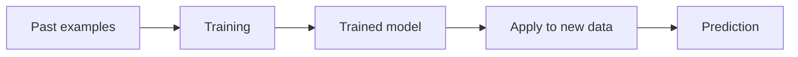

# Machine Learning

**By the end:** You can explain how machine learning learns from examples and when a project actually needs it.

## Overview

Your inbox quietly moved a message to spam this morning. Nobody wrote a rule naming that exact sender. A system learned what spam looks like from millions of messages people had classified before. That is **machine learning**.

### What is machine learning?

**Machine learning (ML)** is a branch of artificial intelligence in which computers learn patterns from data instead of being explicitly programmed for every rule.

Machine learning is a method that data science may use, not another name for data science.

Examples include:

- Email spam detection
- Movie recommendations
- Voice recognition
- Image classification
- Customer-churn prediction

The system learns from past examples during **training**. The trained system is called a **model**. It then uses the patterns it learned to make a prediction or decision about new data.

### When a project actually needs machine learning

Machine learning earns its place when a useful pattern would be too complex to express as a dependable set of rules. Nobody can list every possible sentence that makes a message spam, so the system has to learn from examples.

It is the wrong tool when a simple rule solves the problem or when nobody has collected suitable examples:

| Question | What it needs |
|---|---|
| Which bundle sold most last month? | Counting; this is descriptive analytics |
| Flag any transfer above `$500` | One explicit rule |
| Which customers will stop topping up next month? | A model trained on customers who already stopped |

The third problem is the only machine-learning problem. It is solvable only if the company kept reliable records of who stopped, when they stopped, and what their earlier behaviour looked like. **No examples, no model.**

### Example

The data scientist in the previous lesson investigated why bundle renewals fell. Now the mobile network wants to identify customers who may leave next month.

Past customers provide the training examples. Their earlier top-up frequency, bundle choices, and service history become inputs. Whether they later left provides the known outcome. A model learns patterns connecting those inputs to that outcome, then assigns a risk prediction to current customers.

That prediction does not automatically explain why a customer may leave, and it does not decide what the company should do. It supplies one piece of evidence for people to evaluate and act on.
