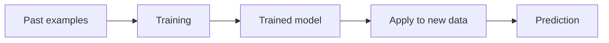

# Machine Learning

**By the end:** You can explain how machine learning learns from examples and when a project actually needs it.

## Overview

Your inbox quietly moved a message to spam this morning. Nobody wrote a rule naming that exact sender. A system learned what spam looks like from millions of messages people had classified before. That is **machine learning**.

### What is machine learning?

**Machine learning (ML)** is a branch of artificial intelligence where computers learn patterns from data instead of being given every rule by a person.

Examples include:

- Email spam detection
- Movie recommendations
- Voice recognition
- Image classification
- Predicting which customers may leave

The system learns from past examples during **training**. The trained system is called a **model**. It then uses the patterns it learned to make a prediction or decision about new data.

### When a project actually needs machine learning

Machine learning is useful when a pattern is too complex for a clear set of rules. Nobody can list every possible sentence that makes a message spam, so the system has to learn from examples.

It is the wrong tool when a simple rule solves the problem or when nobody has collected good examples:

| Question | What it needs |
|---|---|
| Which bundle sold most last month? | Counting; this is descriptive analytics |
| Flag any transfer above `$500` | One explicit rule |
| Which customers will stop topping up next month? | A model trained on customers who already stopped |

The third problem is the only machine-learning problem. It only works if the company kept good records of who stopped, when they stopped, and what their earlier behavior looked like. **No examples, no model.**

### Example

The data scientist in the previous lesson investigated why bundle renewals fell. Now the mobile network wants to identify customers who may leave next month.

Past customers provide the training examples. How often they topped up, which bundles they chose, and their service history become inputs. Whether they later left provides the known answer. A model learns patterns connecting those inputs to that answer, then predicts which current customers may leave.
