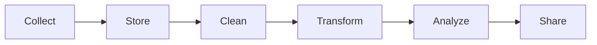

# Where Data Lives and the Data Pipeline

**Chapter:** 2 - The Data Ecosystem  
**Lesson:** 5 of 6  
**By the end:** You can name the stages a dataset passes through, and where it is stored at each one.

## Overview

The sales figure on a manager's dashboard this morning began three weeks ago as a mobile money payment for a sack of rice. Between those two moments it was moved, stored, cleaned, reshaped, and summarized, usually by systems nobody in that meeting has ever seen. Data does not exist in one single place. It moves through systems and stages before it becomes useful.

### Where data lives

Organizations store data in different systems depending on purpose and scale.

| System | Purpose |
|---|---|
| **Database** | Stores and retrieves structured business data for daily operations |
| **Data warehouse** | Stores large amounts of historical data for analysis |
| **Data lake** | Stores raw data in many formats, often at large scale |
| **Spreadsheets / files** | Useful for small datasets and quick work |

The difference that matters is what each one is *for*. A database is built to record what is happening right now, one transaction at a time. A warehouse is built to answer questions about the last three years. Ask a database a three-year question and you will slow down the shop it is running.

### What is a data pipeline?

A **data pipeline** is the path data follows from its source to its final use.

Each stage has a purpose:

- **Collect** - gather data from apps, forms, sensors, or systems
- **Store** - save it in a database, warehouse, or file
- **Clean** - fix missing values, duplicates, and errors
- **Transform** - reshape data into a useful format
- **Analyze** - explore patterns and answer questions
- **Share** - present results in reports or dashboards

### Example

Follow the payment from the top of the lesson.

1. The mobile money system **collects** the payment - amount, time, shop
2. It is **stored** in the payment provider's database, alongside millions of others
3. A pipeline **cleans** the records, dropping the reversed and duplicated ones
4. The data is **transformed** into daily totals per shop
5. An analyst **analyzes** which shops are growing and which are flat
6. The manager sees the result in a **dashboard**, three weeks later

Six stages, and the number on the dashboard is the only one anybody in that meeting will ever see.
