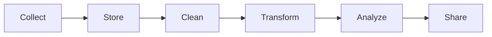

# Where Data Lives and the Data Pipeline

**By the end:** You can name the stages a dataset passes through, and where it is stored at each one.

## Overview

The sales number on a manager's dashboard this morning began three weeks ago as a digital wallet payment for a sack of rice. Between those two moments it was moved, stored, cleaned, changed, and added up, usually by systems most people in the meeting never see. Data does not stay in one place. It moves through systems and stages before it becomes useful.

### Where data lives

Organizations store data in different systems depending on what the data is used for and how much data there is.

| System | Purpose |
|---|---|
| **Database** | Stores business data used every day |
| **Data warehouse** | Stores large amounts of older data for analysis |
| **Data lake** | Stores unprepared data in many formats, often at large scale |
| **Spreadsheets / files** | Useful for small datasets and quick work |

The important difference is what each one is used for. A database records what is happening right now, one transaction at a time. A warehouse answers questions about the last three years. Ask a database a three-year question and you may slow down the shop it is running.

### What is a data pipeline?

A **data pipeline** is the path data follows from where it starts to where it is used.

Each stage has a purpose:

- **Collect** - gather data from apps, forms, sensors, or systems
- **Store** - save it in a database, warehouse, or file
- **Clean** - fix missing data, duplicates, and errors
- **Transform** - reshape data into a useful format
- **Analyze** - explore patterns and answer questions
- **Share** - present results in reports or dashboards

### Example

Follow the payment from the top of the lesson.

1. The digital wallet system **collects** the payment - amount, time, shop
2. It is **stored** in the payment provider's database, alongside millions of others
3. A pipeline **cleans** the records, dropping the reversed and duplicated ones
4. The data is **transformed** into daily totals per shop
5. An analyst **analyzes** which shops are selling more and which are not changing
6. The manager sees the result in a **dashboard**, three weeks later

Six stages, and the number on the dashboard is the only part most people in the meeting will see.
