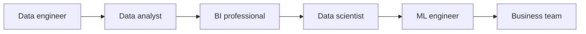

# How These Fields Work Together

**By the end:** You can describe how the data roles depend on each other within a single project.

## Overview

One customer cancels a subscription. Six different contributors end up touching that single event, and not one of them could have handled it alone. Data analysis, business intelligence, data science, machine learning, and data engineering are separate but connected fields. Together with the people who use their results, they form a **data ecosystem**.

### One ecosystem, many roles

In a modern organization, data work is rarely done by one person alone. Instead, teams with different specialties collaborate.

Typical roles include:

- **Data engineer** - builds pipelines and storage
- **Data analyst** - explores data and answers questions
- **BI professional** - builds dashboards and KPI tracking
- **Data scientist** - investigates complex problems and tests possible solutions
- **Machine learning engineer** - puts predictive models into products and keeps them working
- **Business stakeholder** - asks questions and uses the results

The exact job titles vary. In a small organization, one person may perform several of these roles. What matters is the kind of contribution, not the title printed on a business card.

### How they work together

One customer stops renewing their monthly data bundle. Follow the event:

1. A **data engineer** collects the top-up and bundle records and makes them trustworthy
2. A **data analyst** confirms that renewals fell and identifies when and where the decline began
3. A **BI professional** builds a dashboard that keeps the renewal rate visible every week
4. A **data scientist** investigates possible causes and tests whether the evidence supports them
5. If prediction would help, an **ML engineer** puts a model into use to flag customers likely to leave
6. The **business team** decides whether to change the price, offer a smaller bundle, or take another action

The model in step five is not automatic or inevitable. It is added only if predicting individual customers supports the business decision. It also depends on the reliable records from step one and the clearly defined problem investigated in the other steps.

### Where analytics types fit

- **Descriptive analytics** reports that renewals fell
- **Diagnostic analytics** investigates why they fell
- **Predictive analytics** estimates which customers may leave next
- **Prescriptive analytics** compares possible actions and recommends what to do

These are not four separate jobs, and they do not always happen in a perfect line. They are four kinds of questions that different people across the ecosystem may help answer.

### Key takeaway

Nobody in that chain did the whole thing, and nobody needed to. Each participant needed to know what came before their work, what their own contribution added, and how somebody else would use it afterward.

That is the practical value of knowing the ecosystem: not that you will work in all of it, but that you will be handed something by someone and expected to know what it is.
