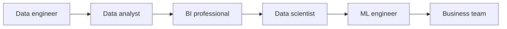

# How These Fields Work Together

**By the end:** You can explain how different data fields work together on one project.

## Overview

A telecom company sees that customers are not renewing their monthly data bundles. No single data field handles the whole problem. Data engineering, data analysis, business intelligence, data science, and machine learning each contribute a different part. Together with the people who use their results, they form a **data ecosystem**.

### How they work together

Here is one way the fields can work together:

1. A **data engineer** collects the top-up and bundle records and makes them trustworthy
2. A **data analyst** confirms that renewals fell and identifies when and where the decline began
3. A **BI professional** builds a dashboard that keeps the renewal rate visible every week
4. A **data scientist** investigates possible causes and tests whether the evidence supports them
5. If prediction would help, a **machine learning engineer** puts a model into use to flag customers likely to leave and makes sure it keeps working
6. The **business team** decides whether to change the price, offer a smaller bundle, or take another action

Each field receives something from the field before it and adds something useful for the next. Not every project needs every step. For example, the business team may be able to act on the analysis without building a machine learning model.

### Where analytics types fit

- **Descriptive analytics** reports that renewals fell
- **Diagnostic analytics** investigates why they fell
- **Predictive analytics** estimates which customers may leave next
- **Prescriptive analytics** compares possible actions and recommends what to do

These are not four separate jobs or four rigid stages. They are questions that people across the data ecosystem help answer.

### Key takeaway

The fields fit together by passing reliable data, findings, tools, and decisions from one part of the project to another. One person may perform several of these roles in a small organization, but the contributions remain connected.
