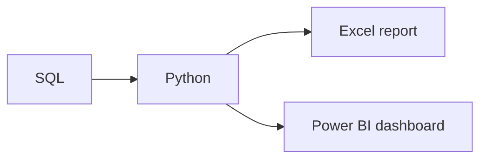

# The Modern Data Toolkit

**By the end:** You can pick the right tool for a task, and describe how several tools combine in one project.

## Overview

Everyone new to data asks which tool to learn first. The honest answer is that the question is backwards: you choose the tool after you know the task, and the right one is usually the smallest that does the job.

### Why there are many tools

No single tool does everything well. Some are built for small datasets, others for large databases, others for dashboards or for writing code, and they overlap enough that most teams run several at once.

You do not need to master all of them. You need to recognise what each one is for, so that when somebody says the word you know roughly what they are about to hand you.

### Core tools in data work

| Tool | What it is | When you reach for it |
|---|---|---|
| **Excel / Google Sheets** | A grid-based **spreadsheet** for organizing and calculating data | Quick analysis, small datasets, business reporting |
| **SQL** | A language for sending a **query**, a request to retrieve data from a database | Retrieving and aggregating data too large for a spreadsheet |
| **Python** | A general programming language | Flexible analysis, cleaning, automation, modeling |
| **Jupyter Notebook** | An interactive place to write and share code | Exploring data step by step, with notes alongside |
| **Power BI** | A tool for building a **dashboard**, a visual display of key metrics and charts | Sharing interactive dashboards with business teams |
| **Git & GitHub** | **Version control**, which tracks changes to files over time | Collaborating and reviewing work before it ships |

Many projects use several tools together. For example, you might use SQL to extract data, Python to clean it, and Power BI to visualize it.

### Example workflow

A typical project pulls sales data out of a database with SQL, cleans and analyzes it in Python, then sends the results two ways: a quick summary in Excel, and a dashboard in Power BI for managers.

Notice that one analysis feeds two outputs, for two audiences. Tools are not a fixed sequence. You pick them per step. Git and GitHub sit underneath the whole flow, recording what changed at each stage.

Two of the tools in that workflow involve writing code. The next lesson explains why the field bothers.
