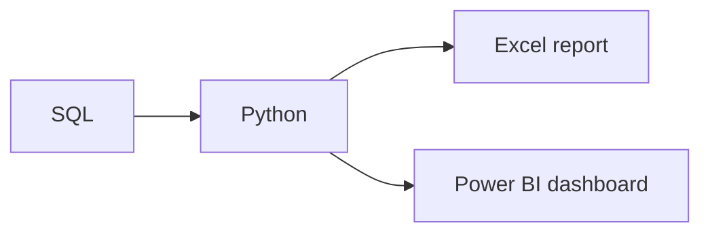

# Modern Data Tools

**By the end:** You can choose the right tool for a task and explain how different tools work together in one project.

## Overview

Everyone new to data asks which tool they should learn first. Before choosing a tool, first understand the task.

The right tool is usually the simplest tool that can do the job well.

### Why there are many tools

No single tool does everything well. Some are made for small datasets. Others work with large databases, dashboards, or code. Because projects have different tasks, teams often use several tools together.

You do not need to master all of them. You only need to understand what each tool is used for.

### Core tools in data work

| Tool | What it is | When you reach for it |
|---|---|---|
| **Excel / Google Sheets** | A **spreadsheet**, a grid used to organize and calculate data | Quick analysis, small datasets, and business reports |
| **SQL** | A language used to send a **query**, a request for data, to a database | Getting and summarizing data from databases |
| **Python** | A general programming language | Data analysis and cleaning |
| **Jupyter Notebook** | A place to write and share code with notes | Exploring data step by step |
| **Power BI** | A tool for building and sharing a **dashboard**, a visual display of important numbers and charts | Sharing interactive dashboards with business teams |
| **Git and GitHub** | Git tracks changes to files, and GitHub helps people share and review them | Tracking changes and reviewing work |

Many projects use several tools together.

### Example workflow

A typical project pulls sales data out of a database with SQL, cleans and analyzes it in Python, then sends the results two ways: a quick summary in Excel, and a dashboard in Power BI for managers.

One project may need several tools. There is no fixed tool or fixed sequence for every project. Choose the right tool for each task.

Git and GitHub can track the changes made throughout the project.

SQL and Python both involve writing code. The next lesson explains why data work uses code.
