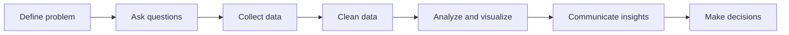

# Defining the Problem and Asking Questions

**Chapter:** 3 — The Data Process  
**Lesson:** 1 of 6  
**By the end:** You can turn a vague request into a specific analytical question.

## Overview

"Can you look into the sales data?" is one of the most common requests an analyst receives, and it is not yet a question. Answering it exactly as written is how a week disappears. Good analysis starts before any data is collected. You must understand the problem and ask clear questions. Without this step, even advanced tools can produce useless results.

### Start with the business problem

A common mistake is jumping straight into data without knowing what you are trying to solve.

Always begin by asking:

- What problem are we trying to solve?
- Who cares about the answer?
- What decision will this analysis support?

Example:

- Weak question: "Let's analyze the sales data."
- Strong question: "Why did sales drop in Burco last quarter, when Hargeisa and Muqdisho held steady?"

For a local shop, the same idea applies:

- Weak question: "Let's look at the sales spreadsheet."
- Strong question: "Why did rice sales drop in the last two weeks compared to the month before?"

### Know your stakeholders

A **stakeholder** is anyone who needs the results of your analysis.

Examples:

- A manager deciding on marketing spend
- A product team improving an app feature
- A finance team reviewing budget performance

Understanding stakeholders helps you:

- Ask the right questions
- Choose relevant metrics
- Present results in a useful way

### How to ask good analytical questions

Good questions are:

- **Specific** — focused on one issue
- **Measurable** — answerable with data
- **Relevant** — connected to a real decision
- **Clear** — easy for others to understand

Examples:

- Which product had the highest return rate last month?
- Are new customers more likely to stop ordering within their first month?
- Which of our three cities is slowest to pay its invoices?

### The same first step, whatever gets built

The fields in Chapter 2 differ in what they produce — a report, a dashboard, a trained model — not in how they start. A data scientist deciding whether a model is worth building asks the same three questions above.

A question no decision depends on is not worth answering, however impressive the method.

### Example

A training centre in Hargeisa notices that fewer students are enrolling.

Stakeholders: the centre manager and the person who runs recruitment  
Problem: enrolment is falling  
Questions:

- When did enrolment start dropping?
- Did it drop across every course, or only some?
- Are fewer people asking about courses, or are the same people asking and not signing up?

These questions guide every step that follows.

## Key Terms

| Term | Definition |
|---|---|
| **Business problem** | The issue or decision the analysis is meant to support |
| **Stakeholder** | A person or group affected by, or interested in, the results of the analysis |
| **Analytical question** | A clear question that data can help answer |
