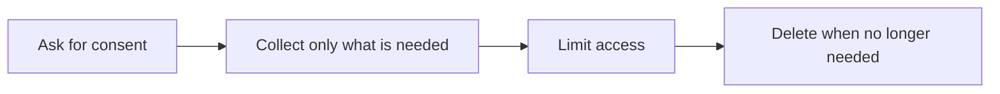

# Privacy, Consent, and Data Security

**Chapter:** 4 - Data Ethics and Privacy

**Lesson:** 2 of 4

**By the end:** You can explain privacy, consent, and simple ways to protect personal data.

## Overview

Personal data can include a person’s name, phone number, location, payments, or health information. This information needs careful protection.

### Privacy and Consent

**Privacy** is a person’s right to control their personal information.

**Consent** means that a person understands how their data will be used and agrees to that use.

### Collect Only What Is Needed

**Data minimization** means collecting only the data needed for a clear purpose.

For example, a mobile-money company may need a customer’s monthly account total to assess a loan. It does not need the name of every person the customer paid.

Collecting less data reduces what could be exposed or misused.

### Protect Data at Every Stage

**Data security** means protecting data from unauthorized access, loss, theft, or hacking.

A privacy policy is not enough by itself. The organization must also control the data in practice.

Simple security checks:

- How many copies of the data exist?
- Who can open each copy?
- Is access recorded?
- When will the data be deleted?
