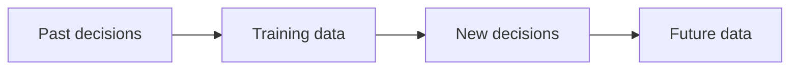

# Bias and Fairness

**Chapter:** 4 - Data Ethics and Privacy

**Lesson:** 3 of 4

**By the end:** You can explain how data can create unfair results and name simple fairness checks.

## Overview

Data may look neutral, but it can contain past human choices and inequalities.

**Bias** is systematic unfairness that produces unjust results.

**Fairness** means checking that a decision does not unfairly harm some people or groups.

### Example: Past Decisions in the Data

A company trains a loan model using old loan records. Most previous loans went to people with registered businesses in the city.

Market traders, rural customers, and people running businesses from home received fewer loans. The data therefore contains less information about whether these customers would repay.

The model may repeat the old approval pattern instead of judging every customer fairly.

### Fields Can Hide Other Information

A field may indirectly reveal information that is not written in the dataset.

For example, a customer’s district may also suggest whether the customer lives in an urban or rural area. This is called a **proxy variable**.

Removing a gender field or another sensitive field does not automatically remove bias. The team must check what the remaining fields may represent.

### How Bias Can Repeat

If a group keeps being rejected, the company receives little new information about that group. Future decisions may then repeat the same problem.

Fairness checks:

- Check whether the data represents all affected groups
- Compare results across groups
- Test the system with a small group before using it widely
- Keep checking results after launch
