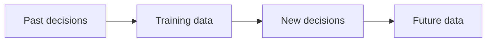

# Bias and Fairness

**Chapter:** 4 - Data Ethics and Privacy

**Lesson:** 3 of 4

**By the end:** You can explain how bias in data can lead to unfair results and name simple fairness checks.

## Overview

Data may look neutral, but it can carry old decisions and unfair patterns.

### Bias and Fairness

**Bias** is a repeated pattern that unfairly helps or harms some people.

**Fairness** means checking that decisions do not unfairly harm a person or group.

### Past Decisions in the Data

A company trains a loan model using old loan records. Most past loans went to registered businesses in the city. Market traders, rural customers, and people running businesses from home received fewer loans.

Because the records contain less information about those customers, the model may repeat the old approval pattern instead of judging everyone fairly.

### Fields Can Hide Other Information

A field can reveal information that is not written directly in the dataset.

For example, a customer’s district may suggest whether they live in a city or rural area. Here, the district is a **proxy variable**: a field that indirectly stands in for other information.

Removing a sensitive field does not automatically remove bias. The team must still check what the remaining fields may represent.

### How Bias Can Repeat

If a group keeps being rejected, the company learns little about how that group would repay. Future decisions may then repeat the same problem.

Fairness checks:

- Check whether the data represents all affected groups
- Compare results across groups
- Test the system with a small group before using it widely
- Keep checking results after launch
