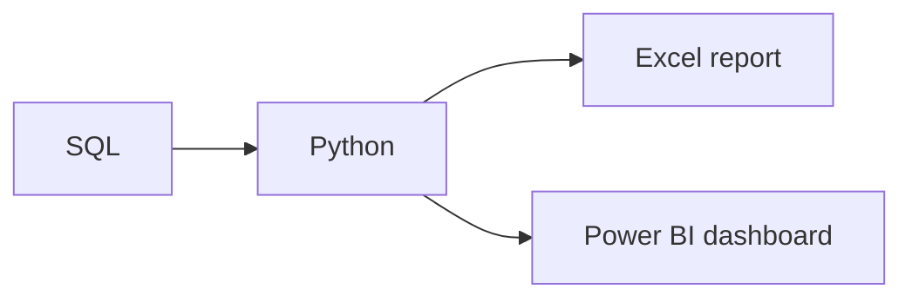

# The Modern Data Toolkit

**Chapter:** 4 — Data in the Real World  
**Lesson:** 1 of 3  
**By the end:** You can pick the right tool for a task, and explain why analysts write code at all.

## Overview

Every new analyst asks which tool to learn first. The honest answer is that the question is backwards: you choose the tool after you know the task, and the right one is usually the smallest that does the job.

### Why there are many tools

No single tool does everything well. Some tools are best for small datasets, others for large databases, and others for building dashboards or writing code.

They also overlap, and most teams use several. As a beginner you do not need to master all of them at once. It is enough to know what each one is for.

### Core tools in data work

| Tool | What it is | When you reach for it |
|---|---|---|
| **Excel / Google Sheets** | Spreadsheets: formulas, charts, pivot tables | Quick analysis, small datasets, business reporting |
| **SQL** | A language for querying databases | Retrieving and aggregating data too large for a spreadsheet |
| **Python** | A general programming language | Flexible analysis, cleaning, automation, modeling |
| **Jupyter Notebook** | An interactive place to write and share code | Exploring data step by step, with notes alongside |
| **Power BI** | A dashboard and reporting tool | Sharing interactive dashboards with business teams |
| **Git & GitHub** | Version control and collaboration | Tracking what changed, and reviewing work before it ships |

Many projects use several tools together. For example, you might use SQL to extract data, Python to clean it, and Power BI to visualize it.

### Why analysts learn to code

Spreadsheets work well until three things happen: the data grows too large, the same report is needed every week, or someone asks you to prove how a number was produced.

Code solves all three. It handles large datasets, it can be re-run on demand, and it leaves a written record of every step you took.

You are not expected to understand the examples coming up. The goal is to see what the work looks like.

**SQL** asks a database a question:

```sql
SELECT region, SUM(sales) AS total_sales
FROM orders
WHERE order_date >= '2024-01-01'
GROUP BY region;
```

That is one question — "how much did each region sell this year?" — answered in four lines.

**Python** loads data and works with it step by step:

```python
import pandas as pd

orders = pd.read_csv("orders.csv")
average_by_region = orders.groupby("region")["sales"].mean()
print(average_by_region)
```

Both examples do something you could also do by hand in a spreadsheet. The difference is that they run in seconds on a million rows, and they run the same way every time.

In this learning path, you will learn the Python language itself first, then return to SQL and to data-specific Python libraries in later courses.

### Example workflow

A typical project pulls sales data out of a database with SQL, cleans and analyzes it in Python, then sends the results two ways: a quick summary in Excel, and a dashboard in Power BI for managers.



Notice that one analysis feeds two outputs, for two audiences. Tools are not a fixed sequence — you pick them per step. Git and GitHub sit underneath the whole flow, recording what changed at each stage.

## Key Terms

| Term | Definition |
|---|---|
| **Spreadsheet** | A grid-based tool for organizing and calculating data |
| **Query** | A request to retrieve data from a database |
| **Dashboard** | A visual display of key metrics and charts |
| **Version control** | Tracking changes to files over time |
