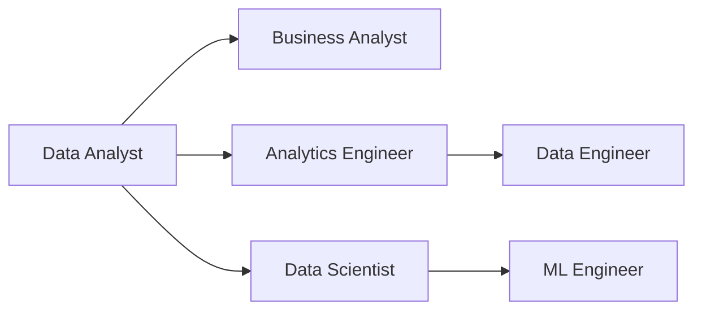

# Careers in Data

**Chapter:** 4 — Data in the Real World  
**Lesson:** 3 of 4  
**By the end:** You can describe the main data roles, and explain how people move between them.

## Overview

Six job titles, heavily overlapping skills, and no agreement between companies about what any of them actually mean. Here is the map.

### How people move between roles

These are not six sealed careers. People move between them, and most start in the same place.

Most people enter through analyst work and move outward from there — toward infrastructure along the top path, toward statistics and modeling along the bottom. Very few enter the field directly at the right-hand end of this diagram; those roles usually come after a few years somewhere else on it.

### Shared skills across data roles

Most data careers benefit from:

- Curiosity and problem-solving
- Basic math and logical thinking
- Communication skills
- Attention to detail
- Willingness to learn tools and methods

Technical skills vary by role, but the ability to work with data and explain results is common to all.

### Common data careers

The clearest way to tell these roles apart is by the question each one is paid to answer.

| Role | The question they answer |
|---|---|
| **Data Analyst** | "What is happening in the business?" |
| **Business Analyst** | "What does the business need, and how can data help?" |
| **Data Engineer** | "How do we collect and store data reliably?" |
| **Data Scientist** | "What patterns and predictions can we find?" |
| **Analytics Engineer** | "How do we create clean, analysis-ready data models?" |
| **Machine Learning Engineer** | "How do we get a model running in production?" |

### How to explore which role fits you

Ask yourself:

- Do I enjoy explaining insights to others? → Analyst / Business Analyst
- Do I enjoy building systems and infrastructure? → Data Engineer
- Do I enjoy coding, statistics, and experiments? → Data Scientist
- Do I enjoy modeling data for reporting teams? → Analytics Engineer
- Do I enjoy software engineering and ML systems? → Machine Learning Engineer

## Key Terms

| Term | Definition |
|---|---|
| **Data Analyst** | A professional who analyzes data to answer business questions |
| **Data Engineer** | A professional who builds data systems and pipelines |
| **Data Scientist** | A professional who uses advanced methods to extract insights and build models |
