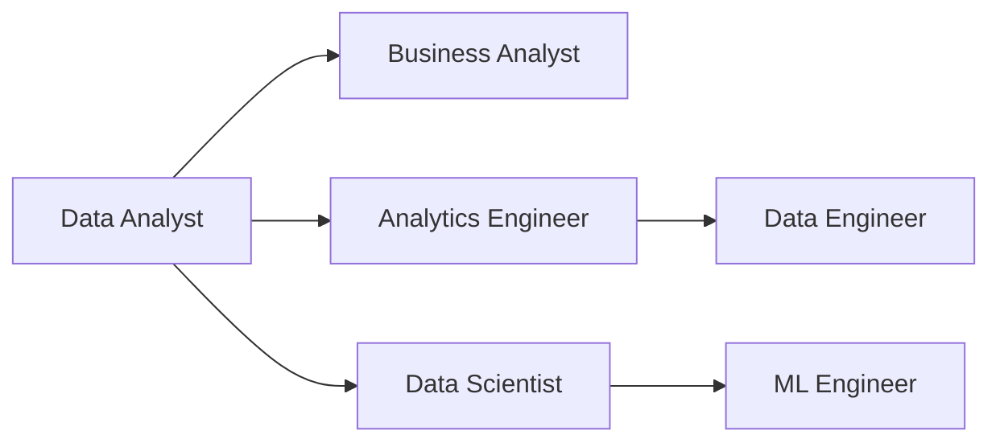

# Careers in Data

**Chapter:** 4 - Data in the Real World  
**Lesson:** 3 of 4  
**By the end:** You can describe the main data roles, and explain how people move between them.

## Overview

Six job titles, heavily overlapping skills, and no agreement between companies about what any of them actually mean. Here is the map.

### How people move between roles

These are not six sealed careers. People move between them, and most start in the same place.

Most people enter through analyst work and move outward from there: toward infrastructure along the top path, toward statistics and modeling along the bottom. Very few enter the field directly at the right-hand end of this diagram; those roles usually come after a few years somewhere else on it.

### Shared skills across data roles

Most data careers benefit from:

- Curiosity and problem-solving
- Basic math and logical thinking
- Communication skills
- Attention to detail
- Willingness to learn tools and methods

Not one of those is a tool, and that is deliberate. The tools on the list change every few years. The habits do not.

### Common data careers

The clearest way to tell these roles apart is by the question each one is paid to answer.

| Role | The question they answer |
|---|---|
| **Data Analyst** | "What is happening in the business?" |
| **Business Analyst** | "What does the business need, and how can data help?" |
| **Data Engineer** | "How do we collect and store data reliably?" |
| **Data Scientist** | "What patterns and predictions can we find?" |
| **Analytics Engineer** | "How do we create clean, analysis-ready data models?" |
| **Machine Learning Engineer** | "How do we put a model into production and keep it running?" |

### The title is not the job

The cold open said there is no agreement between companies about what these titles mean, and that is the practical problem with the map above. One company's Data Analyst writes SQL against a warehouse all day. Another company's Data Analyst never writes a line of it and spends the week in dashboards. A third calls that same dashboard work Business Intelligence, and a fourth calls it Data Science.

So read the description, not the title. The table above is the useful instrument here: whatever a job is called, work out which of those six questions it is actually paid to answer, and you will know what the work is.
