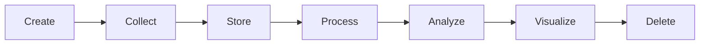

# Course Recap: The Life of One Record

**By the end:** You can follow a single record through its whole life, and name where each stage came from.

## Overview

You have completed the core lessons of this course, and you now have the vocabulary this field runs on. This recap follows one record from the moment it is created to the moment it is deleted, and names who touches it along the way.

### What you learned

This course covered four major areas:

1. **What Is Data?**  
   You learned that data is raw facts, that it comes in different types and formats, that quality matters, and that every record has a life that ends in deletion.

2. **The Data Ecosystem**  
   You learned how analytics, data analysis, BI, data science, machine learning, and data engineering fit together.

3. **Data in the Real World**  
   You learned about common tools, careers, and industry applications.

4. **Data Ethics and Privacy**  
   You learned what responsible use, privacy, bias, and governance each ask of you.

### One record, start to finish

A customer pays `$2.50 per kg` for rice at a shop in Hodan on a Tuesday morning.

| Stage | What happens to the record | Where you met it |
|---|---|---|
| **Create** | The sale happens. It is a fact before anyone records it | Ch 1, the data lifecycle |
| **Collect** | The digital wallet saves the payment as structured, quantitative data | Ch 1, types of data |
| **Store** | It lands in a database, then a warehouse, moved there by a pipeline | Ch 2, where data lives |
| **Process** | Reversed and duplicated payments are dropped, daily totals worked out | Ch 1, data quality |
| **Analyze** | An analyst asks which branch sold least, using a spreadsheet or SQL | Ch 2 and Ch 3, roles and tools |
| **Visualize** | One bar per branch, on a dashboard, read in six seconds | Ch 3, the modern data toolkit |
| **Delete** | After four years the record is archived, then deleted | Ch 4, retention and governance |

Behind the scenes, data engineers maintain the systems, analysts explore the data, dashboards keep results visible, and ethical rules protect the person who made that payment.

### What the record cannot tell you

The number on the dashboard is five stages away from the sack of rice. Each stage was a place where the record could have been corrected, reshaped, dropped, or never made at all.

That distance is the reason this course spent its time on judgment rather than tools. None of it required software. Every idea here is about knowing what a number is worth, and that stays useful when the tools change.
