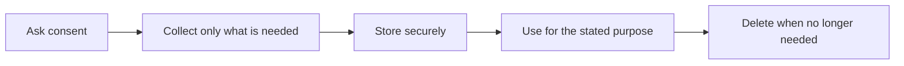

# Privacy, Consent, and Security

**Chapter:** 5 — Data Ethics and Privacy  
**Lesson:** 2 of 4  
**By the end:** You can tell meaningful consent from merely legal consent.

## Overview

Everyone clicked "agree". Almost nobody read it. That is the starting condition for most personal data held anywhere in the world.

**Privacy** means respecting a person's right to control their personal information — names, phone numbers, location, payment details, health records. **Consent** means they understood and agreed to how it would be used.

### Case study: consent in the loan project

The mobile money customers agreed to something when they signed up: to have their money moved and stored.

None of them agreed to have their transaction history scored to decide whether they deserve credit.

The company's legal team points out that the sign-up terms permit "use of account data to improve and develop services." Technically, that covers the loan product.

So ask the harder question instead: **would the customer be surprised?**

A market trader who tops up her phone twice a week never imagined that this pattern would decide whether she can borrow money to expand her stall. If she would be surprised, the consent is weak — even where it is legal.

That is the gap between **legal consent** and **meaningful consent**. Ethical work aims for the second, because the first only protects the company.

### The life of a piece of personal data

Privacy is not one decision made at sign-up. It is a choice made at every stage.

The second stage is the one beginners skip. **Data minimization** means collecting only what the purpose requires, and **anonymization** means removing the details that identify a specific person. Every extra field you keep is one more thing that can leak or be misused.

The loan team planned to pull each customer's full transaction history. Deciding creditworthiness does not require knowing who someone sends money to.

### Why security matters

**Data security** protects data from unauthorized access, loss, or theft — breaches, hacked accounts, lost devices, weak passwords.

A privacy policy means little if the data is not stored securely. Collect only what you need, and restrict access to the people whose work requires it.

## Key Terms

| Term | Definition |
|---|---|
| **Privacy** | The right to control personal information |
| **Consent** | Permission to collect or use data |
| **Data security** | Protecting data from unauthorized access or loss |
| **Data minimization** | Collecting only the data a stated purpose actually requires |
| **Anonymization** | Removing details that could identify a specific person |
