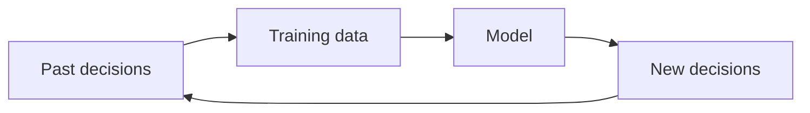

# Bias and Fairness

**Chapter:** 5 — Data Ethics and Privacy  
**Lesson:** 3 of 4  
**By the end:** You can find proxy variables in a dataset, and explain how a biased system makes itself worse over time.

## Overview

A model can sort people by gender using data that contains no gender field anywhere in it. This is not a trick or a rare case — it is the normal outcome.

**Bias** means systematic unfairness that leads to unjust results. Data looks objective, but it usually reflects human choices and past inequalities.

| Source of bias | Example |
|---|---|
| **Sampling bias** | Data comes from only one group |
| **Measurement bias** | Data is collected differently across groups |
| **Historical bias** | Past discrimination is embedded in the data |
| **Reporting bias** | Some events are recorded more than others |

### Case study: bias in the loan project

The team trains the loan model on the company's own lending records — every loan issued by hand over the last three years, and whether it was repaid.

That is the most relevant data available. It is also the problem.

Those manual loans went mostly to customers who walked into a branch with a registered business and a formal address. In practice that meant shop owners in the capital, and mostly men. Market traders, rural customers, and women running businesses from home rarely applied, and were rarely approved when they did.

The model learns from that history. It does not learn *who repays*. It learns *who the company used to approve*.

Now notice something important: the team never put gender in the dataset. They did not need to. The model uses:

- **District of phone registration** — which tracks urban versus rural
- **Has received a business payment** — which tracks formal versus informal business
- **Account age** — which tracks who could afford a phone three years ago

Each of these is a **proxy variable**: a field that stands in for something you did not measure and did not intend to use. Remove gender from the dataset and the model can still sort by gender, straight through the proxies.

This is why "we did not collect sensitive attributes" is not a defense. It only means nobody checked.

### How bias repeats itself

The model rejects market traders because the training data contains few approved market traders. Those rejections become next year's training data, which contains even fewer. The model grows more confident each cycle, and that confidence proves nothing except that it agrees with itself.

A biased system does not stay as wrong as it started. Left alone, it gets worse.

### What fairness means

Fairness is not treating every case identically. It is avoiding unjust harm, and checking whether your outcomes affect some groups differently from others.

- Ask whether the data represents all the groups it will affect
- Compare outcomes across groups, not just overall accuracy
- Test decisions on a small scale before applying them widely

Bias cannot always be removed, but it must be examined openly.

## Key Terms

| Term | Definition |
|---|---|
| **Bias** | Systematic unfairness in data or analysis |
| **Fairness** | Avoiding unjust harm in data-driven decisions |
| **Sampling bias** | When data does not represent the full population fairly |
| **Proxy variable** | A field that indirectly stands in for information you did not measure |
| **Feedback loop** | When a system's own decisions become the data that trains its future decisions |
