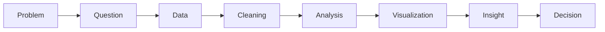

# Course Recap: From Data to Decision

**Chapter:** 6 — Conclusion  
**Lesson:** 1 of 2  
**By the end:** You can describe the full path from problem to decision, and name what comes next in this program.

## Overview

You have completed the core lessons of this course, and you now have the vocabulary that the next ten courses will assume you already know. This recap summarizes the main ideas and shows how they connect in a single journey from raw data to informed decision.

### What you learned

This course covered five major areas:

1. **What Is Data?**  
   You learned that data is raw facts, that it comes in different types and formats, and that quality matters.

2. **The Data Ecosystem**  
   You learned how analytics, data analysis, BI, data science, machine learning, and data engineering fit together.

3. **The Data Analysis Process**  
   You learned the steps from defining a problem to communicating insights and making decisions.

4. **Data in the Real World**  
   You learned about common tools, careers, and industry applications.

5. **Data Ethics and Privacy**  
   You learned that data must be used responsibly, securely, and fairly.

### The full journey

A complete data journey looks like this:

Behind the scenes, data engineers maintain systems, analysts explore data, dashboards share metrics, and ethical rules protect people.

### What comes next

This course is step 1 of an 11-course Data Analysis path. You do not have to pick a direction — the order is already set, and each course builds on the ones before it.

**Phase 1 — Foundations**

2. **Python Fundamentals** — the language itself: variables, control flow, functions, files
3. **Git & GitHub** — version control, so your work is tracked and shareable

**Phase 2 — Data Analysis Fundamentals**

4. **SQL for Data Analysis** — retrieve, filter, join, and aggregate data in databases
5. **Excel for Data Analysis** — formulas, pivot tables, lookups, and basic dashboards
6. **Statistics for Data Analysis** — distributions, sampling, correlation, hypothesis testing

**Phase 3 — Data Analysis with Python**

7. **Data Analysis with Pandas** — work with real datasets in code
8. **Data Cleaning & Data Wrangling** — the cleaning ideas from Chapter 3, in depth
9. **Exploratory Data Analysis (EDA)** — find patterns, outliers, and relationships in an unfamiliar dataset

**Phase 4 — Visualization & Business Intelligence**

10. **Power BI** — data modeling, Power Query, DAX, and published reports
11. **Data Visualization & Storytelling** — choosing the right chart, dashboard design, presenting findings

This course required no software. That changes with the next one — every course after this is hands-on.

## Key Terms

| Term | Definition |
|---|---|
| **Data journey** | The full path from problem to decision using data |
| **Foundation** | The basic knowledge needed before advanced study |
| **Specialization** | Focusing on a specific tool, role, or industry |
