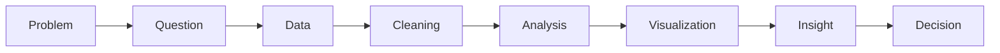

# Course Recap: From Data to Decision

**By the end:** You can describe the full path from problem to decision, and name where each stage came from.

## Overview

You have completed the core lessons of this course, and you now have the vocabulary this field runs on. This recap summarizes the main ideas and shows how they connect in a single journey from raw data to informed decision.

### What you learned

This course covered five major areas:

1. **What Is Data?**  
   You learned that data is raw facts, that it comes in different types and formats, and that quality matters.

2. **The Data Ecosystem**  
   You learned how analytics, data analysis, BI, data science, machine learning, and data engineering fit together.

3. **The Data Process**  
   You learned the steps from defining a problem to communicating insights and making decisions.

4. **Data in the Real World**  
   You learned about common tools, careers, and industry applications.

5. **Data Ethics and Privacy**  
   You learned what responsible use, privacy, bias, and governance each ask of you.

### The full journey

A **data journey** is the full path from a problem to a decision using data:

Behind the scenes, data engineers maintain systems, analysts explore data, dashboards share metrics, and ethical rules protect people.

None of it required software. That was deliberate. Every idea in this course is about judgment, and judgment is what stays useful when the tools change.
